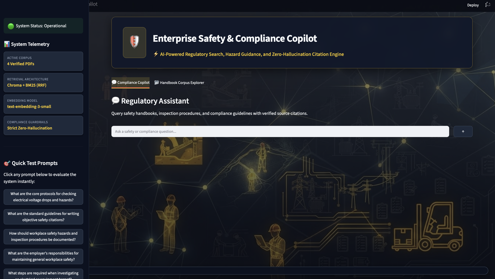
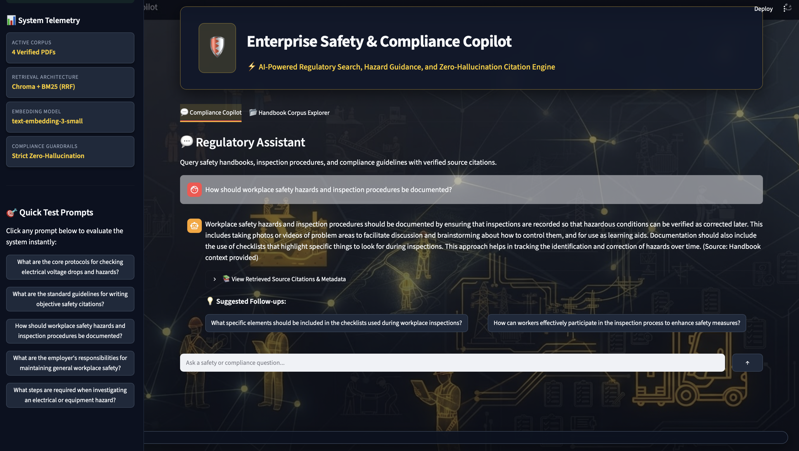
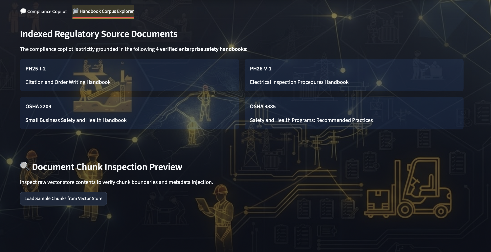
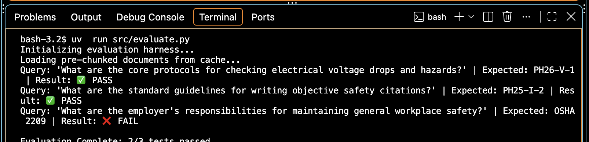

# Enterprise Safety & Compliance Copilot (Week 2 RAG Project)

A production-grade RAG application for querying dense technical safety handbooks and compliance guidelines with source citations.

## What It Uses
- Python 3.11+
- Streamlit UI
- LangChain for orchestration
- ChromaDB for vector search
- BM25 for keyword retrieval
- OpenAI for embeddings and answer generation

## Architecture
Enterprise Safety & Compliance Copilot is built as a grounded RAG system with four main layers:

- **Corpus ingestion** — verified PDF handbooks are loaded from `data/raw/`, cleaned, and split into manageable chunks before indexing.
- **Hybrid retrieval** — ChromaDB provides dense semantic search while BM25 handles exact keyword and citation matching; the two are merged with Reciprocal Rank Fusion.
- **Generation guardrails** — OpenAI generates answers from retrieved context only, with a low-temperature prompt designed to keep responses concise and source-bound.
- **Evaluation and follow-up UX** — the app includes evaluation workflows for retrieval quality and answer faithfulness, plus UI support for guided follow-up questions.

In practice, this means the app is optimized for compliance lookups, citation-heavy questions, and safety guidance where exact wording matters.

## Screenshots
**Home Page**


**Prompt and Response**


**Corpus**


**Evals**


## Repository Layout
- `src/app.py` — Streamlit UI
- `src/ingest.py` — PDF loading, chunking, and cache creation
- `src/retriever.py` — Hybrid dense + BM25 retrieval
- `data/raw/` — local PDF source files, not committed to git
- `data/processed/processed_chunks.pkl` — cached chunks generated during ingestion
- `data/processed/chroma_db/` — local Chroma persistence directory

## Prerequisites
- Python 3.11 or newer
- An OpenAI API key
- `uv` installed locally

## Setup
1. Clone the repository.
2. Install dependencies:
   ```bash
   uv sync
   ```
3. Create a local `.env` file from `.env.example` and add your OpenAI key:
   ```bash
   OPENAI_API_KEY=your_key_here
   ```

## Dataset Setup
This project keeps the source PDFs out of git so the repository stays lightweight and easy to clone. Download the documents below and place them in `data/raw/` using the filenames shown.

You can also download them automatically with:
```bash
uv run python scripts/download_data.py
```

- `General Safety Guidelines.pdf`
  - https://www.osha.gov/sites/default/files/publications/OSHA3886.pdf
- `General safety and Health.pdf`
  - https://www.osha.gov/sites/default/files/publications/SMALL-BUSINESS.pdf
- `PH25-I-2 Citation and Order Writing Handbook 11_18_2025.pdf`
  - https://www.msha.gov/sites/default/files/Directive%20%26%20Guidance/Handbooks/PH25-I-2%20Citation%20and%20Order%20Writing%20Handbook%2011_18_2025.pdf
- `PH26-V-1 Electrical Inspection Procedures Handbook 8_12_2026.pdf`
  - https://www.msha.gov/sites/default/files/Directive%20%26%20Guidance/Handbooks/PH26-V-1%20Electrical%20Inspection%20Procedures%20Handbook%208_12_2026.pdf

## Build the Local Index
After the PDFs are in place, run the app once or run the ingestion step so the local chunk cache and Chroma store are created.

The app will create these artifacts automatically on first run:
- `data/processed/processed_chunks.pkl`
- `data/processed/chroma_db/`

If you want to rebuild from scratch, delete `data/processed/processed_chunks.pkl` and `data/processed/chroma_db/` first.

## Run the App
Start the Streamlit UI with:
```bash
uv run streamlit run src/app.py
```

## Example Use
Ask questions like:
- "What are the general safety responsibilities for workers?"
- "How should an electrical inspection be documented?"
- "What guidance applies to citation and order writing?"

## Troubleshooting
- **Missing API key**: confirm `OPENAI_API_KEY` is set in `.env`.
- **No documents found**: confirm the PDFs are inside `data/raw/` and have `.pdf` extensions.
- **Empty or stale answers**: delete `data/processed/processed_chunks.pkl` and `data/processed/chroma_db/`, then rerun ingestion.
- **Import errors**: rerun `uv sync` to make sure dependencies are installed.

## Notes
- `data/` is ignored in git by design so large PDFs and generated indexes stay local.
- The four source PDFs are the minimum dataset needed for the app to work as intended.

## License
Add a license before publishing publicly so others know how they can reuse the code.
