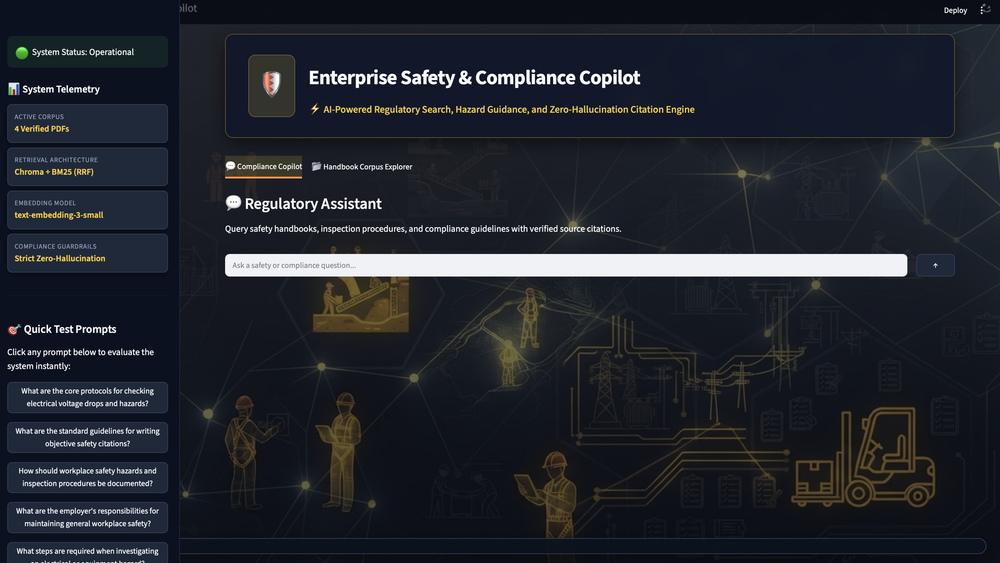
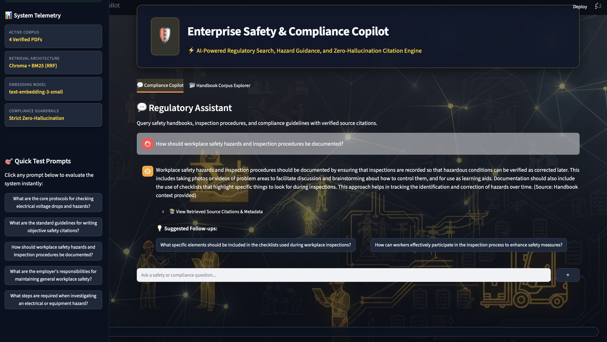
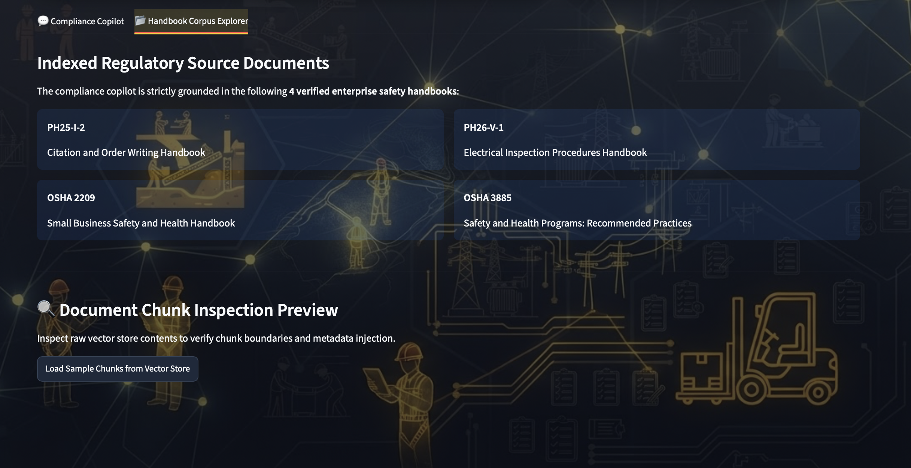
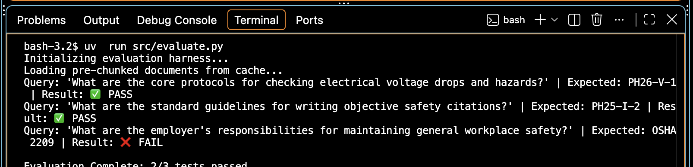

# Enterprise Safety & Compliance Copilot (Week 2 RAG Project)

A Week 2 RAG prototype for querying technical safety handbooks and compliance guidelines using hybrid retrieval and AI-generated answers.

## What It Uses
- Python 3.11+
- Streamlit UI
- LangChain for orchestration
- ChromaDB for vector search
- BM25 for keyword retrieval
- OpenAI for embeddings and answer generation

## Architecture
Enterprise Safety & Compliance Copilot is built as a grounded RAG system with four main layers:

- **Corpus ingestion** — verified PDF handbooks are loaded from `data/raw/`, cleaned, and split into manageable chunks before indexing.
- **Hybrid retrieval** — ChromaDB provides dense semantic search while BM25 handles exact keyword and citation matching; the two are merged with Reciprocal Rank Fusion.
- **Generation guardrails** — OpenAI is prompted to answer using retrieved context and cite the handbook source. Evidence checks and source/page labels in the answer context remain planned improvements.
- **Evaluation and follow-up UX** — the app includes evaluation workflows for retrieval quality and answer faithfulness, plus UI support for guided follow-up questions.

In practice, this means the app is optimized for compliance lookups, citation-heavy questions, and safety guidance where exact wording matters.

## Active Implementation Settings

- **PDF loading:** `PyMuPDFLoader`.
- **Text cleaning:** replace newlines with spaces and trim surrounding whitespace. Headers, footers, and page numbers are not explicitly removed.
- **Chunking:** `RecursiveCharacterTextSplitter` with `chunk_size=1000` and `chunk_overlap=200`. These values are measured in characters, not tokens.
- **Embeddings:** OpenAI `text-embedding-3-small`, with no explicit dimensions override.
- **Retrieval:** Chroma and BM25 each retrieve up to five chunks. Reciprocal Rank Fusion combines their rankings and returns up to five chunks.
- **Answer generation:** `gpt-4o-mini` with `temperature=0.1`.

The active chunking and embedding settings are defined directly in `src/ingest.py` and `src/retriever.py`. The chunking constants in `src/config.py` are not used by the current application path.

## Current Limitations

The answer prompt receives retrieved chunk text without explicit source filename or page labels. Source filenames are displayed separately in the UI.

Answer generation currently runs even when retrieval returns no evidence. The application also has no explicit relevance check that blocks unsupported answers.

Planned improvements are to pass source and page labels into the answer context and return an unsupported response when evidence is empty or irrelevant. The current prompt requests context-based answers, but this behavior is not guaranteed.

## Screenshots
**Home Page**


**Prompt and Response**


**Corpus**


**Evals**


## Repository Layout
- `src/app.py` — Streamlit UI
- `src/ingest.py` — PDF loading, chunking, and cache creation
- `src/retriever.py` — Hybrid dense + BM25 retrieval
- `data/raw/` — local PDF source files, not committed to git
- `data/processed/processed_chunks.pkl` — cached chunks generated during ingestion
- `data/processed/chroma_db/` — local Chroma persistence directory

## Prerequisites
- Python 3.11 or newer
- An OpenAI API key
- `uv` installed locally

## Setup
1. Clone the repository.
2. Install dependencies:
   ```bash
   uv sync
   ```
3. Create a local `.env` file from `.env.example` and add your OpenAI key:
   ```bash
   OPENAI_API_KEY=your_key_here
   ```

## Dataset Setup
This project keeps the source PDFs out of git so the repository stays lightweight and easy to clone. Download the documents below and place them in `data/raw/` using the filenames shown.

You can also download them automatically with:
```bash
uv run python scripts/download_data.py
```

- `General Safety Guidelines.pdf`
  - https://www.osha.gov/sites/default/files/publications/OSHA3886.pdf
- `General safety and Health.pdf`
  - https://www.osha.gov/sites/default/files/publications/SMALL-BUSINESS.pdf
- `PH25-I-2 Citation and Order Writing Handbook 11_18_2025.pdf`
  - https://www.msha.gov/sites/default/files/Directive%20%26%20Guidance/Handbooks/PH25-I-2%20Citation%20and%20Order%20Writing%20Handbook%2011_18_2025.pdf
- `PH26-V-1 Electrical Inspection Procedures Handbook 8_12_2026.pdf`
  - https://www.msha.gov/sites/default/files/Directive%20%26%20Guidance/Handbooks/PH26-V-1%20Electrical%20Inspection%20Procedures%20Handbook%208_12_2026.pdf

## Build the Local Index
After the PDFs are in place, start the app:
```bash
uv run streamlit run src/app.py
```

On first run, the app creates:
- `data/processed/processed_chunks.pkl` — the processed chunk cache.
- `data/processed/chroma_db/` — the Chroma vector index.

After changing source PDFs, chunking settings, or the embedding model, stop the app, delete both the chunk cache file and the Chroma directory listed above, then restart the app to rebuild them.

## Run the App
Start the Streamlit UI with:
```bash
uv run streamlit run src/app.py
```

## Example Use
Ask questions like:
- "What are the general safety responsibilities for workers?"
- "How should an electrical inspection be documented?"
- "What guidance applies to citation and order writing?"

## Troubleshooting
- **Missing API key**: confirm `OPENAI_API_KEY` is set in `.env`.
- **No documents found**: confirm the PDFs are inside `data/raw/` and have `.pdf` extensions.
- **Stale index**: delete `data/processed/processed_chunks.pkl` and `data/processed/chroma_db/`, then rerun ingestion.
- **Import errors**: rerun `uv sync` to make sure dependencies are installed.

## Notes
- `data/` is ignored in git by design so large PDFs and generated indexes stay local.
- The four source PDFs are the minimum dataset needed for the app to work as intended.

## License
Add a license before publishing publicly so others know how they can reuse the code.
